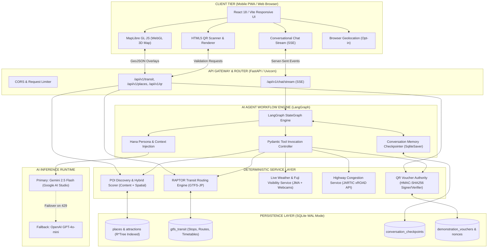
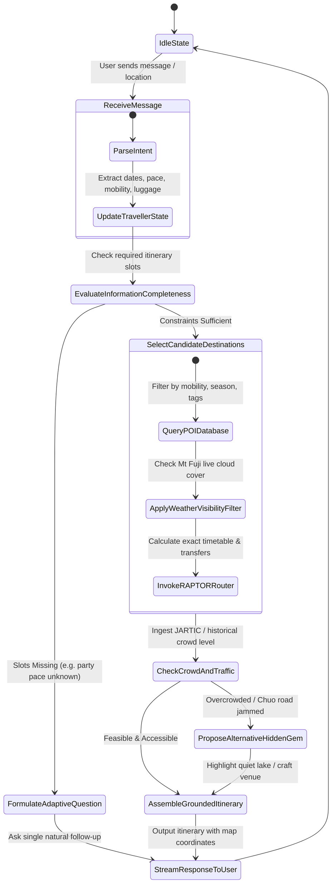
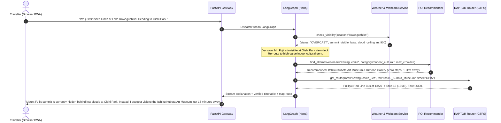
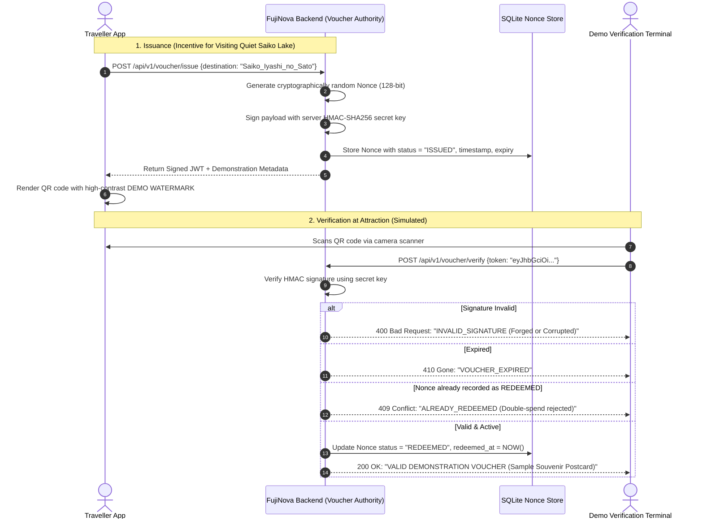

# FUJINOVA — System Architecture & Component Design Specification

**Document Version:** 1.0.0  
**Status:** COMPLETE (Stage 0 Discovery)  
**Author:** FujiNova Lead Enterprise Architect  

---

## 1. Architectural Overview

FujiNova employs a **Decoupled Agentic Hybrid Architecture**. The system establishes a strict boundary between the **Probabilistic AI Layer** (Hana's natural conversation, adaptive questioning, and intent parsing) and the **Deterministic Domain Layer** (transit routing, spatial lookups, cryptographic signing, and sensor queries).

Under no circumstances is the LLM permitted to perform mathematical pathfinding, timetable calculations, or signature verification. The AI agent acts strictly as an empathetic orchestrator that interfaces with validated backend micro-tools.

---

## 2. Comprehensive System Architecture Diagram



---

## 3. Dynamic Conversational State Machine (LangGraph)

Hana does not follow a linear questionnaire. Instead, she executes a cyclic **Traveller State Schema Evaluation** loop:



### The Traveller State Schema (Pydantic / LangGraph State)

```python
from typing import List, Optional
from pydantic import BaseModel, Field

class TravellerProfile(BaseModel):
    origin_station: Optional[str] = Field(None, description="Starting transit hub (e.g. Shinjuku, Otsuki, Kawaguchiko)")
    arrival_time: Optional[str] = Field(None, description="ISO time or HH:MM of arrival")
    departure_time: Optional[str] = Field(None, description="Must-return departure time")
    party_composition: Optional[str] = Field(None, description="solo, couple, family_with_kids, elderly")
    mobility_limitations: bool = Field(False, description="True if avoiding steep stairs or long walks")
    preferred_pace: str = Field("relaxed", description="relaxed (1-2 POIs/day) or active (3-5 POIs/day)")
    interests: List[str] = Field(default_factory=list, description="nature, photography, hot_springs, shrines, food, crafts")
    budget_tier: str = Field("standard", description="budget, standard, luxury")
    luggage_status: Optional[str] = Field(None, description="carrying_large_suitcases, daypack_only, coin_lockered")
    fuji_view_priority: int = Field(5, description="1 to 5 importance of seeing Mt. Fuji summit")
```

---

## 4. End-to-End Sequence: Real-Time Dynamic Re-Routing

This sequence illustrates how Hana handles a sudden weather disruption without hallucinating alternatives:



---

## 5. Security & Verification Architecture: The Demonstration QR Voucher

To demonstrate crowd dispersion incentives responsibly without issuing fake commercial currency, FujiNova implements a tamper-evident voucher workflow:



---

## 6. Architectural Boundary Enforcement Summary

1. **LLM Output Sanitization:** All LLM outputs must be parsed into strictly typed Pydantic models. Raw markdown emitted by the LLM is never parsed as a source of transit truth.
2. **Spatial Precision:** Coordinates use the WGS84 standard format (`float64`) truncated to 6 decimal places (~0.1 meter accuracy).
3. **Data Provenance:** Every response card rendered in the frontend must show its provenance badge (e.g. `[Verified via Fujikyu Bus GTFS March 2025]` or `[Historical Estimate]`).
