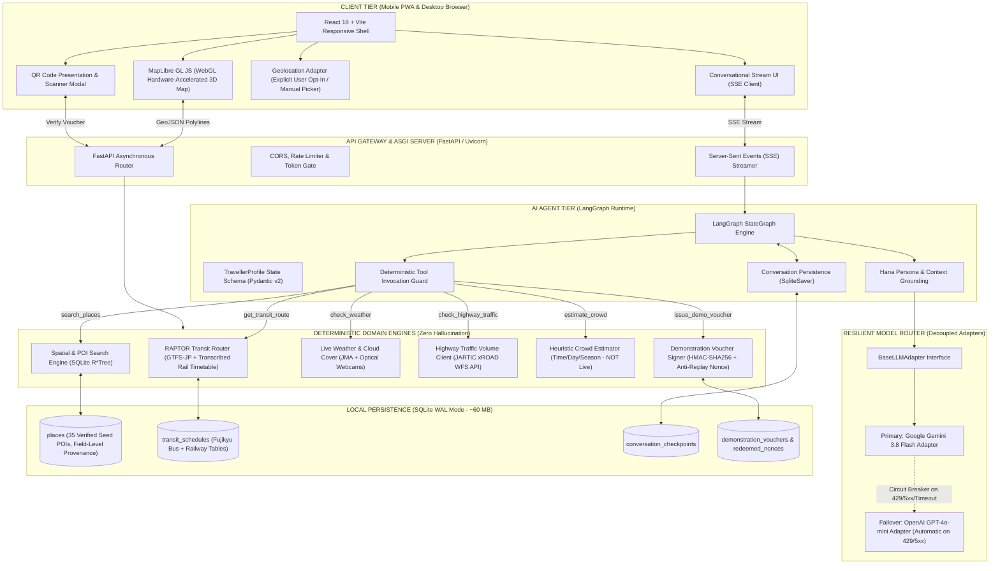
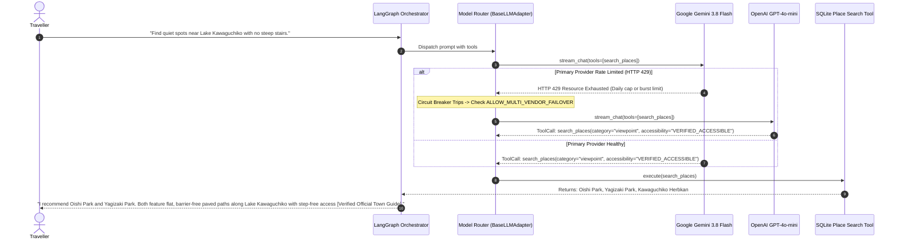

# FUJINOVA — Updated System Architecture & Responsibility Boundaries

**Document Version:** 2.1.0 (Stage 0.3 Final Readiness Revision)  
**Status:** AUDITED & VALIDATED  
**Validation Date:** November 2026  
**Auditor:** FujiNova Principal Enterprise Architect  

---

## 1. Architectural Principles & Boundary Governance

The FujiNova architecture is built on strict separation of concerns between probabilistic conversational AI and deterministic computational services:

1. **Dual Cloud Model Router with Decoupled Adapters:** The application interacts with models solely via an abstract `BaseLLMAdapter` interface. Swapping between primary (`gemini-3.8-flash`) and fallback (`gpt-4o-mini`) is driven by backend environment configuration (`.env`).
2. **Deterministic Service Layer:** Routing calculations, spatial proximity queries, coordinate lookups, and voucher signing run in isolated, pure-Python / SQLite components with **zero LLM improvisation**.
3. **Field-Level Data Provenance:** The persistence layer explicitly records the source, retrieval date, verification status, and freshness of every geographical and facility attribute.
4. **Zero-Overhead Local Development:** Runs smoothly within the 16 GB RAM and 4 GB VRAM budget of Windows 11 host without requiring Docker Desktop, Kubernetes, or background Java JVMs.

---

## 2. Updated System Architecture Diagram



---

## 3. Strict Functional Responsibility Boundaries

```
+----------------------------------------------------------------------------------------------------+
|                                STRICT BOUNDARY OF RESPONSIBILITY                                   |
+----------------------------------------------------------------------------------------------------+
| DOMAIN / TASK               | ASSIGNED SUBSYSTEM   | FORBIDDEN ACTION                              |
+-----------------------------+----------------------+-----------------------------------------------+
| Conversational Interview    | Hana (LangGraph/LLM) | No hardcoded rigid question trees.            |
| Traveller Need Extraction   | Hana (Pydantic v2)   | No silent dropping of stated constraints.     |
| Destination Suggestion      | POI Search Engine    | Hana CANNOT suggest uncataloged places.       |
| Route & Timetable Planning  | RAPTOR Transit Engine| Hana CANNOT calculate or guess schedules.     |
| Transit Fare Computation    | RAPTOR Fare Tables   | Hana CANNOT invent or estimate ticket prices. |
| Weather & Mountain View     | JMA / Webcam Service | Hana CANNOT guess weather without sensor tool.|
| Road Congestion Assessment  | JARTIC Traffic / Rule| Hana CANNOT invent live traffic speeds.       |
| Attraction Crowd Status     | Crowd Heuristic Model| Hana CANNOT label an estimate as "Live".      |
| Demonstration Pass Issuing  | HMAC Token Authority | Hana CANNOT generate arbitrary pass codes.    |
+----------------------------------------------------------------------------------------------------+
```

---

## 4. Failure Handling & Circuit Breaker Architecture

A robust application must gracefully handle external network, quota, and operational failures:



---

## 5. Security & Privacy Safeguards

1. **User Geolocation Privacy:**
   - Browser GPS is requested exclusively through a deliberate user click on an explicit consent dialog.
   - If permission is denied or dismissed, the app seamlessly defaults to an intuitive **Manual Location Selector** (e.g. "Select Station / Landmark").
   - User coordinates are processed ephemerally in session memory and **never logged to persistent disk or analytics servers**.
2. **Demonstration Voucher Tamper-Proofing:**
   - Demonstration QR passes are cryptographically signed using server-side HMAC-SHA256 with an ephemeral server secret.
   - Every pass contains a cryptographically random 128-bit `nonce`. Upon scanning, the nonce is stored in SQLite with a `REDEEMED` status. Any duplicate scan attempt returns `ALREADY_REDEEMED`.
   - Every voucher screen displays prominent high-contrast watermarks: **"DEMONSTRATION ONLY — NON-COMMERCIAL VOUCHER"**.
3. **No Biometric or Surveillance Tools:**
   - The application strictly contains zero facial recognition, camera biometric capture, or cross-site tracking libraries.
